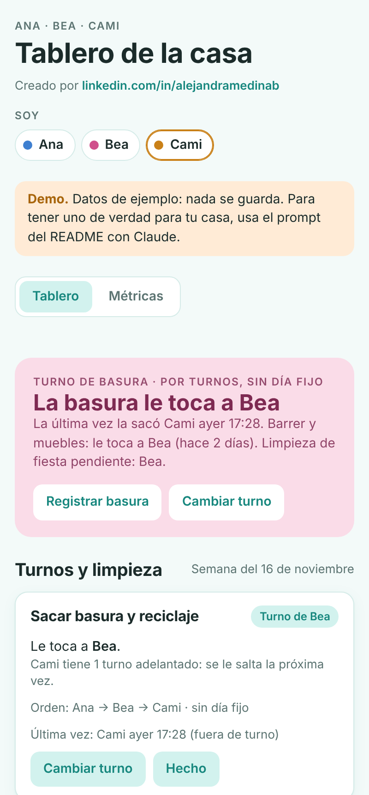
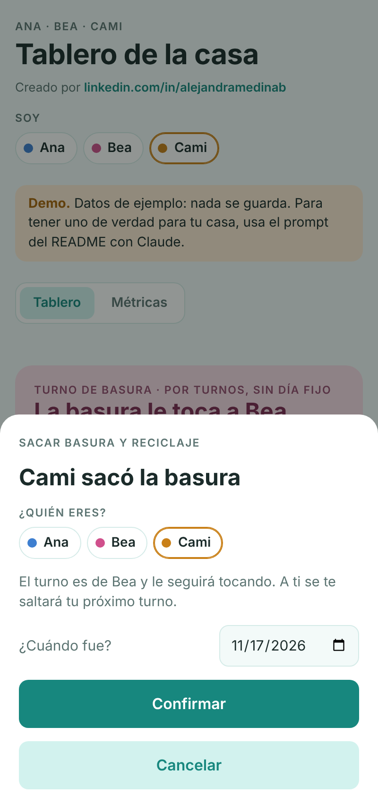
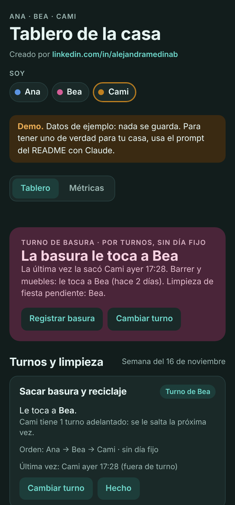
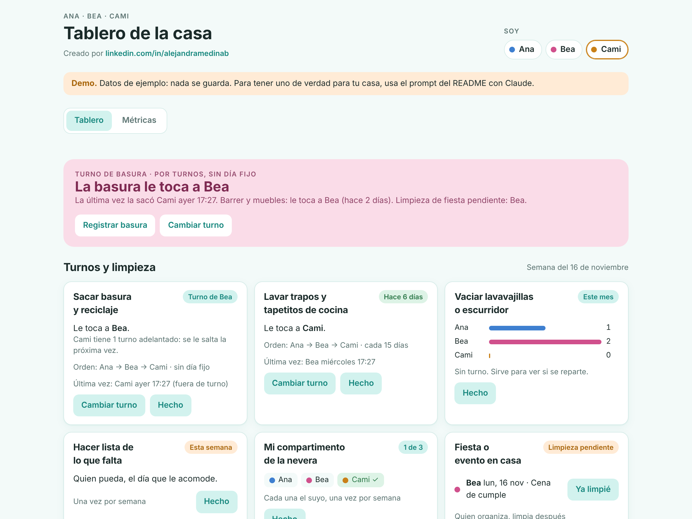
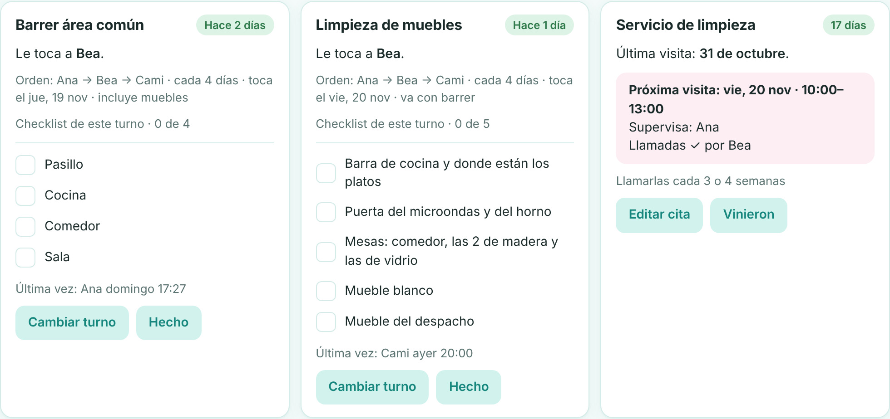
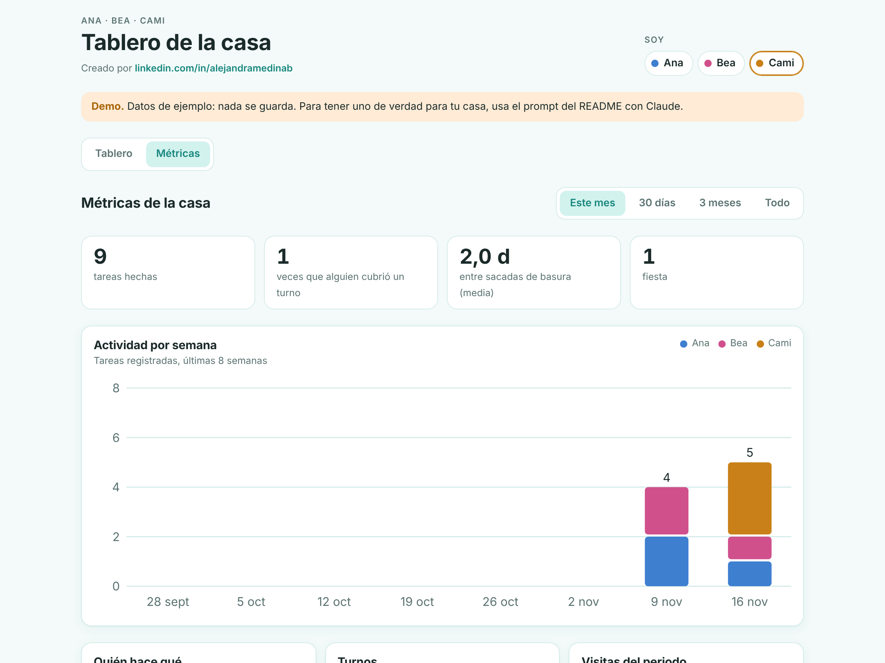

# Tablero de tareas para roomies

[English](README.md) · **Español**

**© 2026 [Maria Alejandra Medina Barreto](https://www.linkedin.com/in/alejandramedinab) · Licencia MIT**

Un tablero compartido de tareas para un piso compartido, que funciona con etiquetas NFC. Acercas el móvil al cubo de basura y el tablero se abre en "Saqué la basura". Con un toque más queda registrado quién lo hizo y cuándo. Sin instalar ninguna app y sin configurar el móvil de nadie.

Lo construí en unas tres semanas de ida y vuelta con [Claude](https://claude.ai), para tres roomies y un paquete de 50 etiquetas NFC que costó 11 euros.

> **Este repositorio es una demo.** `index.html` funciona con datos de ejemplo (las roomies "Ana", "Bea" y "Cami") y no guarda nada. El tablero de verdad funciona como un artifact de Claude con una base de datos compartida. Para crear uno para tu casa, pega el [prompt de abajo](#crea-el-tuyo) en Claude.

<p>
  
  
  
</p>

## Cómo funciona

1. Cada etiqueta NFC guarda el enlace del tablero más una terminación corta, por ejemplo `#basura` o `#barrer`.
2. Al acercar un iPhone desbloqueado a la etiqueta aparece una notificación. Al abrirla, se llega directo a la pantalla de confirmar esa tarea.
3. La primera vez, cada persona toca su nombre. El móvil lo recuerda.
4. Cada registro (quién, qué y cuándo) se guarda en una base de datos compartida, así toda la casa ve lo mismo.

## Funciones

| Parte | Qué hace |
| --- | --- |
| Turnos rotativos | Basura, trapos y barrer rotan A → B → C. Barrer y limpiar muebles van juntos, cada 4 días. |
| Checklists | Barrer y muebles se dividen por zonas. Al marcar todo, la tarea queda hecha. |
| Reglas justas | Si haces el turno de otra, a ella le sigue tocando y a ti se te salta tu próximo turno. Sale un aviso tras 2 turnos seguidos sin hacer. Los toques dobles cuentan una vez. |
| Cambiar turno | Pasa un turno a otra persona, con la misma lógica de "turno que se debe". |
| Servicio de limpieza | Días desde la última visita y la próxima cita: día, horario, quién supervisa y si ya se les llamó. |
| Fiesta o evento | Quien organiza tiene una "limpieza pendiente" hasta que toca "Ya limpié". |
| Lista de compras | Lista de "se acabó…" a la que cualquiera puede añadir y tachar. |
| Visitas | Registro de invitados, con aviso cuando la misma persona llega a 4 noches o más en 30 días. |
| Mantenimiento | Reporta algo roto; quien lo gestiona va rotando. Pendiente → Avisado al casero → Arreglado. |
| Métricas | Actividad semanal por persona, tabla de quién hace qué, turnos cubiertos y visitas. |

<p>
  
</p>
<p>
  
</p>
<p>
  
</p>

## Las iteraciones que más ayudaron

La primera versión funcionó desde el primer día. Lo útil vino al vivir con ella:

1. **Un enlace en cada etiqueta, no una automatización en cada móvil.** Nadie tiene que configurar nada.
2. **Un tablero que interpreta el registro, no solo un formulario.** Responde "¿a quién le toca?" en lugar de listar filas.
3. **Turnos en lugar de días fijos.** Los días fijos fallaron la primera vez que alguien se fue de viaje.
4. **Checklists por zona.** Se acabó discutir qué cuenta como "limpio".
5. **Probarlo con todas, no solo conmigo.** A los cinco días solo se guardaba lo mío: un ajuste al compartir hacía que las demás solo pudieran ver.
6. **"Te sigue tocando."** Cubrir a alguien antes borraba su turno. Ahora a la dueña del turno le sigue tocando y a quien ayudó se le salta el próximo.
7. **Quitar funciones.** Borramos el control de gastos porque ya usamos Splitwise.

## Crea el tuyo

Pega esto en Claude y cambia todo lo que está entre [corchetes]:

```markdown
Vivo con [N] roomies ([Nombre A], [Nombre B], [Nombre C]) y todas usamos [iPhone / Android]. Compré etiquetas NFC (NTAG215). Crea un tablero compartido de tareas de la casa como una sola página web con una base de datos compartida, para que todas veamos y guardemos lo mismo.

ETIQUETAS NFC
- Cada etiqueta guarda el enlace del tablero más una terminación corta (por ejemplo #basura). Al acercar el móvil se abre directo la pantalla de "Hecho" de esa tarea.
- Pon al final del tablero la lista de enlaces de todas las etiquetas, con un botón para copiar.
- La primera vez, cada persona toca su nombre y el móvil lo recuerda. Cada registro guarda quién, qué y cuándo, con un selector de fecha para registrar algo más tarde.

TAREAS (adáptalas a tu casa)
- Turnos rotativos en el orden [A -> B -> C]: [sacar la basura]; [barrer + limpiar muebles cada 4 días, la misma persona hace las dos]; [lavar los trapos de cocina cada 15 días].
- Barrer y muebles tienen cada una su checklist por zonas: [pasillo, cocina, comedor, sala] / [barra, puerta del microondas, mesas, muebles]. Al marcar todo, la tarea queda hecha.
- Semanal: [hacer la lista de lo que falta], [cada una limpia su compartimento de la nevera].
- Solo contador, sin turnos: [vaciar el lavavajillas].
- Servicio de limpieza: días desde la última visita y la próxima cita (día, horario, quién supervisa y si ya se les llamó).
- Fiesta o evento: quien organiza tiene una "limpieza pendiente" hasta que toca "Ya limpié".

REGLAS JUSTAS
- Si alguien hace una tarea fuera de su turno, a quien le tocaba le sigue tocando y a quien ayudó se le salta su próximo turno.
- Un botón de "Cambiar turno" que siga la misma lógica.
- Muestra un aviso cuando alguien lleve [2] turnos seguidos que han hecho otras.
- Los toques dobles (misma persona, misma tarea, en menos de 30 minutos) cuentan solo una vez.

ADEMÁS
- Lista de "se acabó"; registro de visitas (quién invita, invitado, tipo, noches; aviso a partir de [4] noches en 30 días); reportes de mantenimiento con una persona responsable que va rotando (Pendiente -> Avisado al casero -> Arreglado); historial con opción de borrar; pestaña de Métricas con un gráfico semanal por persona.

DISEÑO
- Pensado primero para el móvil, [tonos pastel turquesa y rosa], modo claro y oscuro, un color por persona.

IMPORTANTE
- Todo se guarda en la base de datos compartida. Si alguien no puede guardar, muestra un aviso claro, nunca datos de ejemplo.
- Dime cómo compartirlo: invitar a cada roomie como editora.
```

Después:

1. Comparte el tablero con cada roomie como **editora**. Quien solo pueda ver no podrá guardar nada.
2. Graba el enlace de cada tarea en una etiqueta con una app gratis como NFC Tools (Escribir → Añadir un registro → URL).
3. Pega las etiquetas donde se hace cada tarea: cubo de basura, escoba, armario de limpieza.

## Prueba la demo

Abre `index.html` en el navegador, o activa **GitHub Pages** en este repositorio (Settings → Pages → Deploy from a branch → `main` / root) para tener un enlace público. La demo se reinicia cada vez que recargas la página.

## Notas

- La interfaz está en español porque es lo que hablamos en casa.
- Un solo archivo: HTML, CSS y JavaScript dentro de la misma página. Las fuentes se cargan desde Google Fonts.
- La versión real necesita el entorno de artifacts de Claude para la base de datos compartida. Fuera de él, la página pasa a modo demo.

## Licencia

Este proyecto tiene licencia MIT. Consulta [LICENSE](LICENSE).
