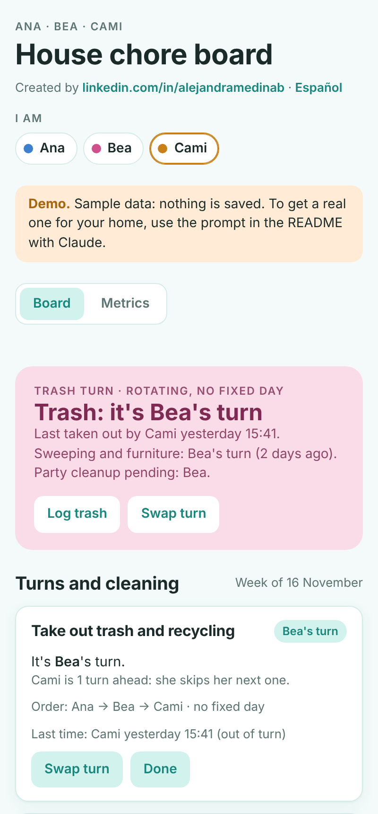
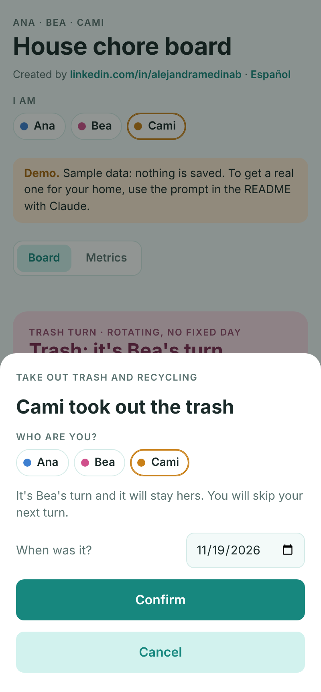
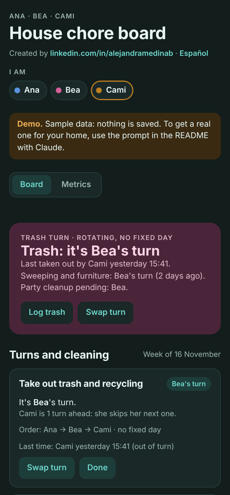
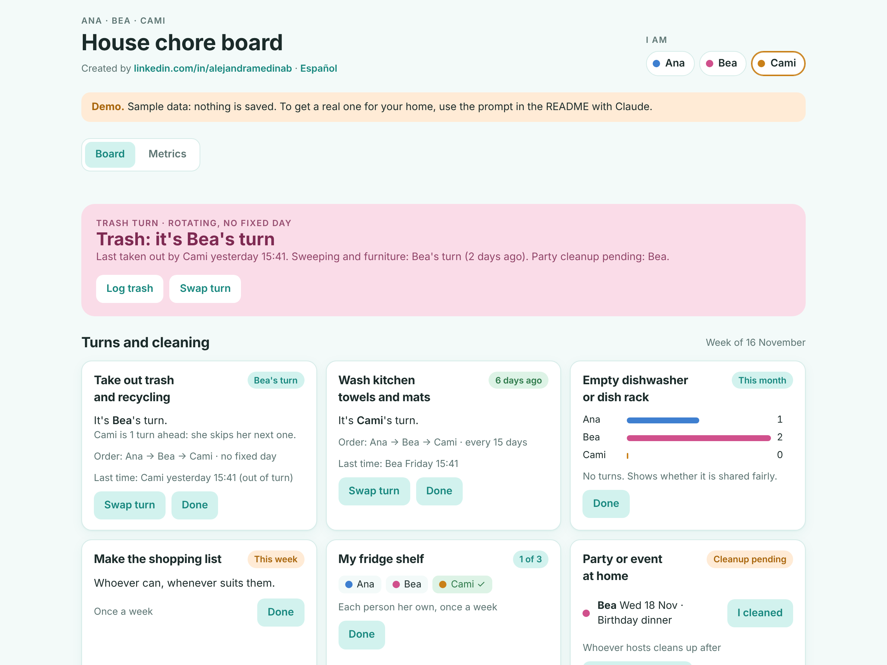
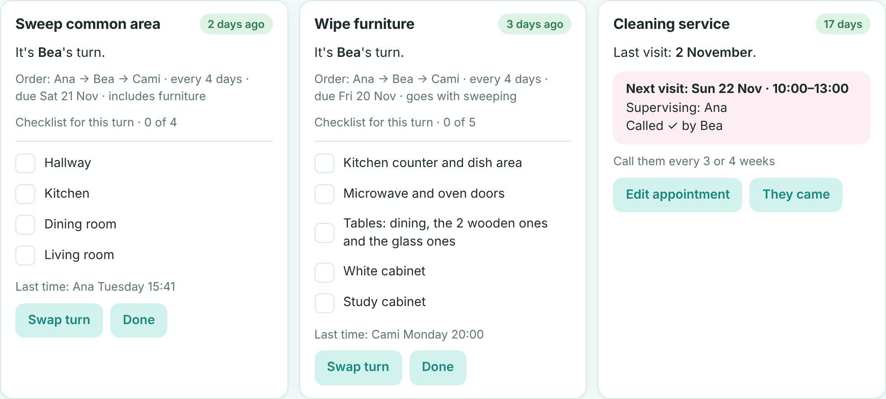
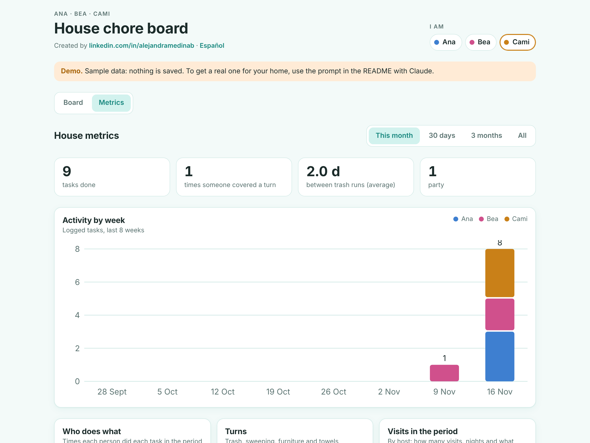

# Roommate Chore Board

**English** · [Español](README.es.md)

**© 2026 [Maria Alejandra Medina Barreto](https://www.linkedin.com/in/alejandramedinab) · MIT License**

A shared chore board for a shared apartment, driven by NFC stickers. Tap your phone on the trash bin and the board opens on "Took out the trash". One more tap logs who did it and when. No app to install, no setup on anyone's phone.

Built in about three weeks of back-and-forth with [Claude](https://claude.ai), for three roommates and a pack of 50 NFC stickers that cost 11 euros.

> **This repo is a demo.** `index.en.html` (English) and `index.html` (Spanish) run with sample data (roommates "Ana", "Bea" and "Cami") and saves nothing. The real board runs as a Claude artifact with a shared database. To build one for your home, paste the [prompt below](#build-your-own) into Claude.

<p>
  
  
  
</p>

## How it works

1. Each NFC sticker stores the board's link plus a short ending, for example `#basura` (trash) or `#barrer` (sweeping).
2. Tapping a sticker with an unlocked iPhone shows a notification. Opening it lands on that task's confirm screen.
3. The first time, each person taps her name. The phone remembers it.
4. Every record (who, what, when) goes to a shared database, so the whole house sees the same state.

## Features

| Area | What it does |
| --- | --- |
| Rotating turns | Trash, towels and sweeping rotate A → B → C. Sweeping and furniture wiping go together, every 4 days. |
| Checklists | Sweeping and furniture split into rooms. Ticking every item marks the task done. |
| Fairness rules | If you do someone else's turn, she still owes it and you skip your next one. An alert shows after 2 missed turns in a row. Double taps count once. |
| Swap turn | Pass a turn to someone else, with the same "owed turn" logic. |
| Cleaners | Days since the last visit, plus the next visit: date, time slot, who supervises, whether someone called them. |
| Party / event | The host owns a "cleanup pending" item until she taps "I cleaned". |
| Shopping list | "Ran out of…" list anyone can add to and tick off. |
| Visits | Guest log with a heads-up when the same guest reaches 4+ nights in 30 days. |
| Maintenance | Report something broken; the person in charge rotates. Pending → Landlord notified → Fixed. |
| Metrics | Weekly activity by person, who-does-what table, covered turns, visits. |

<p>
  
</p>
<p>
  
</p>
<p>
  
</p>

## Iterations that mattered

The first version worked on day one. The useful part came from living with it:

1. **A link on every tag, not an automation on every phone.** Zero setup for anyone.
2. **A board that reads the log, not just a form.** It answers "whose turn is it?" instead of listing rows.
3. **Turns instead of weekdays.** Fixed days broke the first time someone travelled.
4. **Checklists per room.** No more debating what "clean" means.
5. **Testing with everyone, not just me.** After five days only my taps were saving: a sharing setting made the others view-only.
6. **"You still owe it."** Covering for someone used to erase her turn. Now the owner keeps it and the helper skips her next one.
7. **Removing features.** We deleted the expense tracker because we already use Splitwise.

## Build your own

Paste this into Claude and replace everything in [brackets]:

```markdown
I live with [N] roommates ([Name A], [Name B], [Name C]) and we all use [iPhone / Android]. I bought NFC stickers (NTAG215). Build us a shared house chore board as a single web page with a shared database, so everyone sees and saves the same data.

NFC TAGS
- Each sticker stores the board's link plus a short ending (e.g. #trash). Tapping it opens the board straight on that task's "Done" screen.
- List every tag link at the bottom with a copy button.
- First time, each person taps her name; the phone remembers it. Every record saves who, what and when, with a date picker for late entries.

CHORES (edit to fit your home)
- Rotating turns in the order [A -> B -> C]: [take out trash]; [sweep + wipe furniture every 4 days, same person does both]; [wash kitchen towels every 15 days].
- Sweeping and furniture each have a room checklist: [hallway, kitchen, dining room, living room] / [counter, microwave door, tables, shelves]. Ticking every item marks the task done.
- Weekly: [shopping list], [each person cleans her fridge shelf].
- Counter only, no turns: [emptying the dishwasher].
- Cleaners: days since the last visit, plus the next visit (date, time slot, who supervises, whether someone already called them).
- Party/event: the host owns a "cleanup pending" item until she taps "I cleaned".

FAIRNESS RULES
- If someone does a task out of turn, the person whose turn it was still owes it, and the helper skips her own next turn.
- A "Swap turn" button follows the same logic.
- Show an alert when someone has [2] turns in a row done by others.
- Count double taps (same person, same task, within 30 minutes) only once.

ALSO
- "Ran out of" shopping list; visits log (host, guest, type, nights; flag [4]+ nights in 30 days); maintenance reports with a rotating person in charge (Pending -> Landlord notified -> Fixed); history with delete; Metrics tab with a weekly chart by person.

DESIGN
- Mobile first, [pastel turquoise and pink], light and dark mode, one colour per person.

IMPORTANT
- Everything saves to the shared database. If someone can't save, show a clear warning, never sample data.
- Tell me how to share it: invite each roommate as an editor.
```

Then:

1. Share the board with each roommate as an **editor**. Viewers can see it but their taps won't save.
2. Write each task's link onto a sticker with a free app such as NFC Tools (Write → Add a record → URL).
3. Stick the tags where the chores happen: trash bin, broom, cleaning cupboard.

## Try the demo

Open `index.en.html` (English) or `index.html` (Spanish) in a browser, or turn on **GitHub Pages** for this repo (Settings → Pages → Deploy from branch → `main` / root) to get a public link. The demo resets on every reload.

## Notes

- The board comes in two languages: `index.en.html` (English) and `index.html` (Spanish, the one we use at home).
- Single file: HTML, CSS and JavaScript inline. Fonts load from Google Fonts.
- The live version needs Claude's artifact runtime for the shared database; outside it the page falls back to demo mode.

## License

MIT. See [LICENSE](LICENSE).
