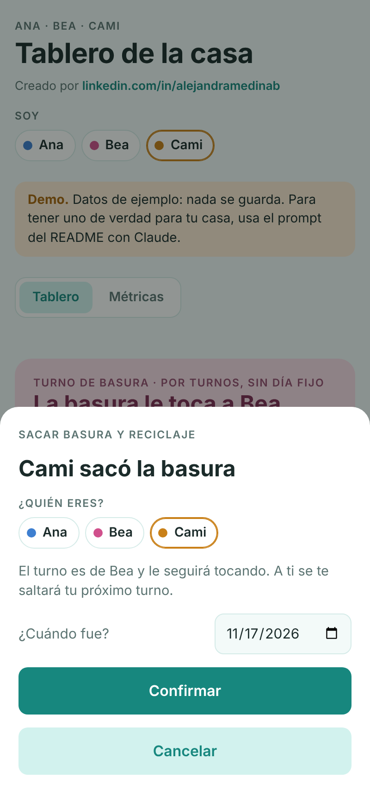
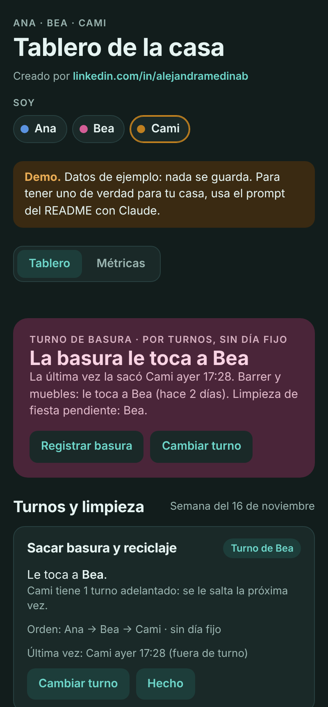
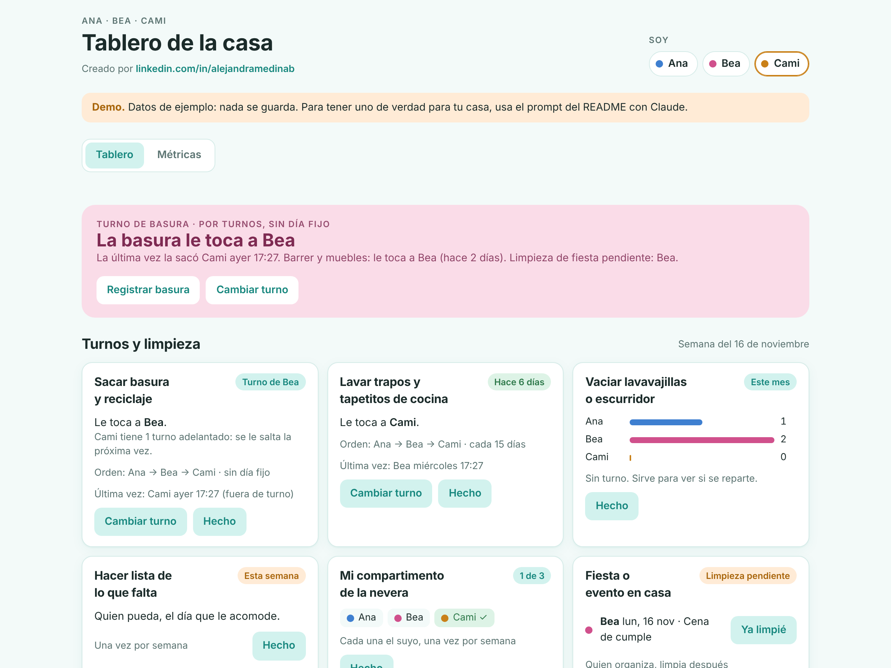
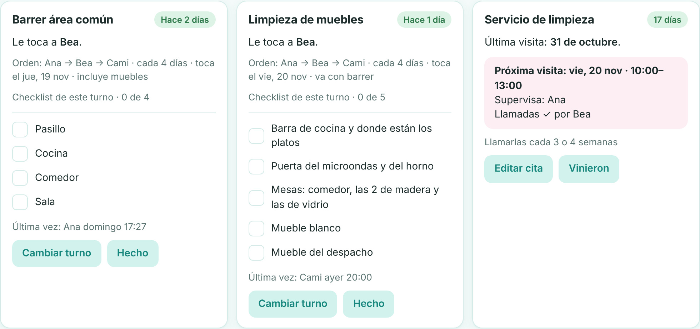
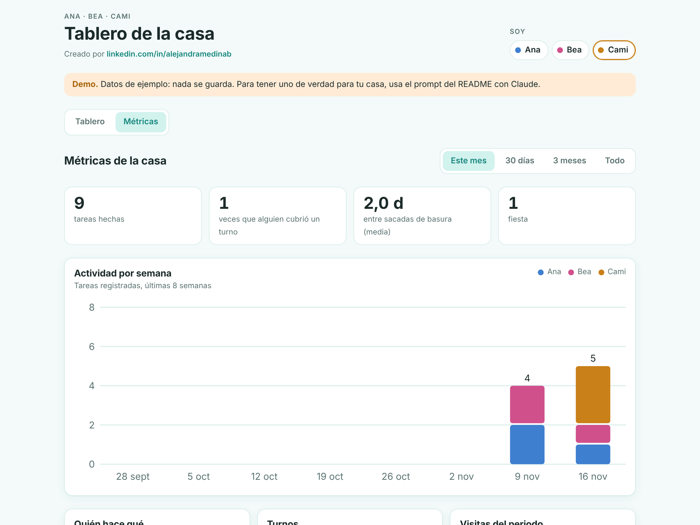

# Roommate chore board

[English](README.md) · [Español](README.es.md)

**© 2026 [Maria Alejandra Medina Barreto](https://www.linkedin.com/in/alejandramedinab) · MIT License**

A shared chore board for a flat, driven by NFC tags. Tap your phone on the bin and the board opens on "Took out the rubbish." One more tap records who did it and when. No app to install and no phone setup.

I built it over about three weeks with [Claude](https://claude.ai), for three flatmates and a pack of 50 NFC tags that cost €11.

> **This repository is a demo.** `index.html` runs on sample data (the flatmates "Ana", "Bea" and "Cami") and saves nothing. The real board runs as a Claude artifact with a shared database. To make one for your own flat, paste the [prompt below](#make-your-own) into Claude.

<p>
  
  
  
</p>

## How it works

1. Each NFC tag stores the board link plus a short suffix, for example `#basura` or `#barrer`.
2. Tapping an unlocked iPhone on the tag shows a notification. Opening it goes straight to the confirm screen for that task.
3. The first time, each person taps their name. The phone remembers it.
4. Every record (who, what and when) goes into a shared database, so the whole flat sees the same thing.

## Features

| Area | What it does |
| --- | --- |
| Rotating turns | Bins, cloths and sweeping rotate A → B → C. Sweeping and furniture go together, every 4 days. |
| Checklists | Sweeping and furniture are split by area. Ticking everything marks the task done. |
| Fair rules | If you do someone else's turn, they keep their turn and you skip your next one. A warning appears after 2 turns missed in a row. Double taps count once. |
| Swap turn | Pass a turn to someone else, using the same "owed turn" logic. |
| Cleaning service | Days since the last visit and the next appointment: day, time, who supervises and whether they've been called. |
| Party or event | The host has a pending clean-up until someone taps "Cleaned up." |
| Shopping list | A "we've run out of…" list anyone can add to and tick off. |
| Visits | Guest log, with a warning when the same person reaches 4+ nights in 30 days. |
| Maintenance | Report something broken. The person handling it rotates. Pending → Landlord notified → Fixed. |
| Metrics | Weekly activity per person, a who-does-what table, covered turns and visits. |

<p>
  
</p>
<p>
  
</p>
<p>
  
</p>

## Iterations that helped most

The first version worked from day one. The useful changes came from living with it:

1. **One link on each tag, not an automation on each phone.** Nobody has to set anything up.
2. **A board that reads the log, not just a form.** It answers "whose turn is it?" rather than listing rows.
3. **Turns instead of fixed days.** Fixed days failed the first time someone went away.
4. **Checklists per area.** No more arguing about what counts as "clean."
5. **Testing with everyone, not just me.** After five days only my records were being saved, because a sharing setting meant the others could only view.
6. **"Still your turn."** Covering for someone used to erase their turn. Now the owner keeps the turn and the helper skips their next one.
7. **Removing features.** We dropped expense tracking because we already use Splitwise.

## Make your own

Paste this into Claude and change everything in [brackets]:

```markdown
I live with [N] flatmates ([Name A], [Name B], [Name C]) and we all use [iPhone / Android]. I bought NFC tags (NTAG215). Build a shared household chore board as a single web page with a shared database, so we all see and save the same thing.

NFC TAGS
- Each tag stores the board link plus a short suffix (for example #basura). Tapping the phone opens that task's "Done" screen directly.
- At the bottom of the board, list the links for all tags, with a copy button.
- The first time, each person taps their name and the phone remembers it. Every record stores who, what and when, with a date picker to log something later.

TASKS (adapt to your flat)
- Rotating turns in the order [A -> B -> C]: [take out the rubbish]; [sweep + clean furniture every 4 days, the same person does both]; [wash kitchen cloths every 15 days].
- Sweeping and furniture each have their own checklist by area: [hall, kitchen, dining room, living room] / [kitchen counter, microwave door, tables, cabinets]. Ticking everything marks the task done.
- Weekly: [write the shopping list], [each person cleans their fridge shelf].
- Counter only, no turns: [empty the dishwasher].
- Cleaning service: days since the last visit and the next appointment (day, time, who supervises and whether they've been called).
- Party or event: the host has a pending clean-up until someone taps "Cleaned up."

FAIR RULES
- If someone does a task outside their turn, the owner keeps their turn and the helper skips their next one.
- A "Swap turn" button using the same logic.
- Show a warning when someone has missed [2] turns in a row.
- Double taps (same person, same task, within 30 minutes) count once.

ALSO
- "We've run out" list; visit log (host, guest, type, nights; warning from [4] nights in 30 days); maintenance reports with a rotating owner (Pending -> Landlord notified -> Fixed); history with delete; Metrics tab with a weekly chart per person.

DESIGN
- Mobile first, [soft turquoise and pink tones], light and dark mode, one colour per person.

IMPORTANT
- Everything is saved in the shared database. If someone can't save, show a clear message, never sample data.
- Tell me how to share it: invite each flatmate as an editor.
```

Then:

1. Share the board with each flatmate as an **editor**. Anyone who can only view can't save anything.
2. Write each task's link onto a tag with a free app such as NFC Tools (Write → Add a record → URL).
3. Stick the tags where each task happens: the bin, the broom, the cleaning cupboard.

## Try the demo

Open `index.html` in a browser, or turn on **GitHub Pages** for this repository (Settings → Pages → Deploy from a branch → `main` / root) to get a public link. The demo resets every time you reload the page.

## Notes

- The interface is in Spanish because that's what we speak at home. The Spanish README is [README.es.md](README.es.md).
- One file: HTML, CSS and JavaScript in the same page. Fonts load from Google Fonts.
- The real version needs Claude's artifact environment for the shared database. Outside it, the page falls back to demo mode.

## License

MIT. See [LICENSE](LICENSE).
